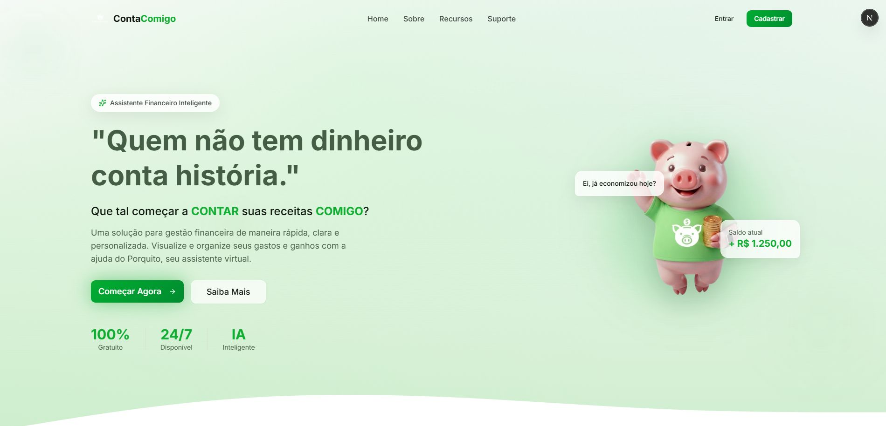
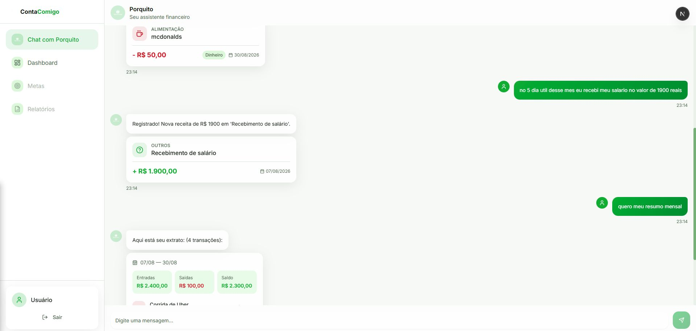

<div align="center">

<!-- 🖼️ LOGO: coloque o arquivo em docs/images/logo.png (ajuste width se necessário) -->


### Que tal começar a **CONTAR** suas receitas **COMIGO**?

Assistente de gestão financeira pessoal via chat com IA: registre gastos e ganhos e consulte seu extrato conversando em linguagem natural, sem formulários.


</div>

---

## 📸 Preview

<p align="center">
  
</p>

<p align="center">
  
</p>

---

## 💡 Sobre o projeto

O **ContaComigo** é um micro-SaaS de finanças pessoais entregue como um chat. Em vez de preencher formulários e escolher categorias manualmente, você conversa com o **Porquito**, o assistente do app:

> *"gastei 45 reais no mercado ontem no pix"*
> → o Porquito entende, registra a despesa (valor, categoria, forma de pagamento e data) e mostra um card com a transação.

> *"quanto gastei com transporte nos últimos 30 dias?"*
> → o Porquito monta o extrato com os filtros que você pediu.

O produto é pensado para o público brasileiro: português como idioma padrão, valores no formato pt-BR e datas relativas como "ontem" e "semana passada".

---

## 🚧 Status do projeto

O projeto está em **desenvolvimento ativo** (Fase 2 de 3).

| Fase | Escopo | Status |
| --- | --- | --- |
| 1 | CRUD de usuários, conversas, transações e mensagens + autenticação JWT | ✅ Concluída |
| 2 | Integração com IA (Spring AI + Google Gemini) para interpretar mensagens | 🔄 Em andamento |
| 3 | Agente com tool calling, memória de conversa e conselhos financeiros | 📝 Planejada |

### ✅ Já funciona

- Cadastro e login com JWT
- Criação e gerenciamento de conversas
- **Registro de transações por linguagem natural** (receitas e despesas)
- **Consulta de extrato por linguagem natural**, com filtros de período, categoria, tipo e forma de pagamento
- Histórico de mensagens paginado
- Edição e exclusão de transações
- Proteção contra acesso a recursos de outros usuários (IDOR)

### 🔜 Planejado

- Endpoint de saldo e dashboard com gráficos
- Respostas do Porquito geradas pela IA (mais naturais)
- Conversa livre dentro do contexto financeiro
- Dicas e recomendações financeiras personalizadas
- Definição de prioridades/limites de gastos por categoria
- Testes automatizados e documentação Swagger/OpenAPI
- Docker para ambiente de desenvolvimento

---

## 🧠 Como funciona

A IA é o "cérebro" do parsing: ela decide a **intenção** da mensagem e extrai os dados estruturados. O backend apenas roteia e persiste.

```text
Mensagem do usuário
        │
        ▼
POST /conversation/{id}/message/send
        │
        ▼
GeminiMessageAnalyzer (Spring AI + Gemini, structured output)
        │
        ▼
AiMessageAnalysisDTO (intent + campos extraídos)
        │
        ├── REGISTER_TRANSACTION ─► cria a transação ─► resposta + card
        ├── QUERY_EXTRACT ────────► aplica filtros ───► resposta + extrato
        └── UNKNOWN ──────────────► mensagem de orientação
```

Toda resposta da API segue o mesmo formato (`MessageInteractionDTO`): mensagem do usuário, resposta do Porquito e, quando aplicável, os dados da transação ou do extrato. Assim o frontend renderiza o card sem precisar de uma segunda chamada.

> O saldo **nunca é armazenado**: o princípio do projeto é calculá-lo dinamicamente a partir do histórico de transações.

---

## 🛠️ Stack

**Back-end**

- Java 17 e Spring Boot 4.x
- Spring Security + JWT (stateless)
- Spring Data JPA (com Specifications para filtros dinâmicos)
- PostgreSQL com migrations via Flyway
- Spring AI + Google Gemini (`ChatClient` com structured output)
- Bean Validation, Lombok

---

## 🚀 Como rodar localmente

### Pré-requisitos

- JDK 17+
- PostgreSQL rodando localmente (ou em container)
- Node.js 18+ (para o front-end)
- Uma chave de API do Gemini ([Google AI Studio](https://aistudio.google.com/))

### 1. Clone o repositório

```bash
git clone https://github.com/ocauaatdev/SEU-REPOSITORIO.git
cd SEU-REPOSITORIO
```

### 2. Crie o banco de dados

```sql
CREATE DATABASE contacomigo;
```

> O schema é criado automaticamente pelo Flyway na primeira execução.

### 3. Configure as variáveis de ambiente

| Variável | Descrição | Exemplo |
| --- | --- | --- |
| `DB_HOST` | Host e porta do PostgreSQL | `localhost:5432` |
| `DB_USERNAME` | Usuário do banco | `user` |
| `DB_PASSWORD` | Senha do banco | `sua_senha` |
| `JWT_SECRET_CC` | Segredo para assinar o JWT (mín. 32 caracteres em produção) | `uma-chave-longa-e-aleatoria` |
| `GEMINI_API_KEY` | Chave da API do Gemini | `AIza...` |

Exemplo (Linux/macOS):

```bash
export DB_HOST=localhost:5432
export DB_USERNAME=user
export DB_PASSWORD=sua_senha
export JWT_SECRET_CC=uma-chave-longa-e-aleatoria
export GEMINI_API_KEY=sua_chave_aqui
```

No Windows (PowerShell), use `$env:DB_HOST="localhost:5432"` e assim por diante.

### 4. Suba o back-end

```bash
./mvnw spring-boot:run
```

A API ficará disponível em `http://localhost:8080` (porta padrão do Spring Boot).


---

## 📡 Endpoints principais

Todas as rotas, exceto cadastro e login, exigem o header `Authorization: Bearer <token>`.

| Método | Rota | Descrição |
| --- | --- | --- |
| POST | `/user/register` | Cadastro de usuário |
| POST | `/auth/login` | Login (retorna o JWT) |
| POST | `/conversation/new` | Cria uma conversa |
| GET | `/conversation` | Lista as conversas do usuário |
| POST | `/conversation/{id}/message/send` | Envia mensagem ao Porquito |
| GET | `/conversation/{id}/message` | Histórico paginado |
| GET | `/transaction` | Lista transações (filtros opcionais) |
| PATCH | `/transaction/{id}` | Edita uma transação |
| DELETE | `/transaction/{id}` | Remove uma transação |

---

## 🗂️ Estrutura do back-end

```text
src/main/java/.../
├── ai/            # AiMessageAnalyzer + GeminiMessageAnalyzer (Spring AI)
├── controller/    # Camada HTTP
├── service/       # Regras de negócio
├── repository/    # Spring Data JPA
├── entity/        # Entidades JPA
├── dto/           # Records de entrada e saída
├── security/      # JWT, filtro e configuração de segurança
├── exception/     # Exceções customizadas + handler centralizado
└── util/          # Parsers auxiliares
```

> Ajuste os nomes das pastas para refletir a estrutura real do repositório.

---

## 🗺️ Roadmap resumido

- [x] **Fase 1:** CRUD + autenticação JWT
- [ ] **Fase 2:** integração com IA (registro e extrato funcionando; robustez e saldo em andamento)
- [ ] **Fase 3:** tool calling, memória de conversa, conselhos e prioridades de gastos

---

## 👤 Autor

**Cauã Araujo Teixeira**
Estudante de Análise e Desenvolvimento de Sistemas na FIAP.

[](https://github.com/ocauaatdev)

 [](https://www.linkedin.com/in/caua-araujo-teixeira) 

---

<div align="center">
Feito com ☕ e muito aprendizado.
</div>